

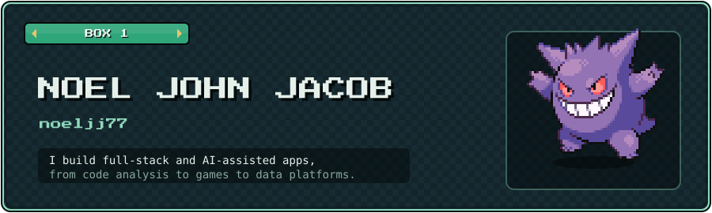

  

<table>
<tr>
<td><a href="https://github.com/noeljj77/RepInspect">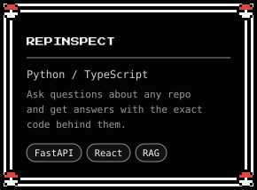</a></td>
<td><a href="https://github.com/noeljj77/SideTracked">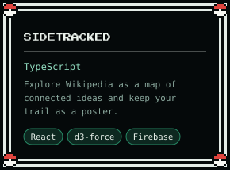</a></td>
<td><a href="https://github.com/noeljj77/SilhouDex">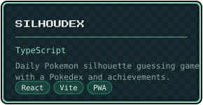</a></td>
</tr>
<tr>
<td><a href="https://github.com/noeljj77/FinPath">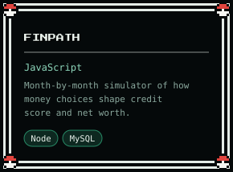</a></td>
<td><a href="https://github.com/noeljj77/digital-twin-wdn-genai">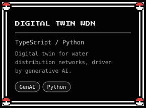</a></td>
<td><a href="https://github.com/noeljj77/realtime-fraud-platform">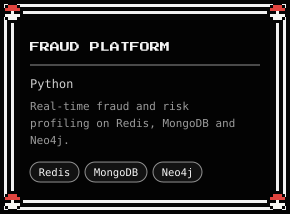</a></td>
</tr>
</table>

 

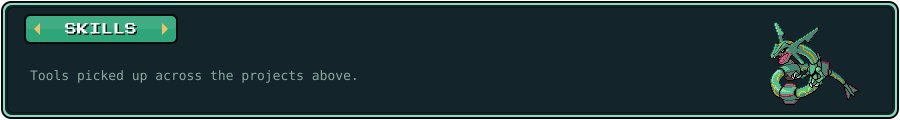

<table>
<tr>
<td>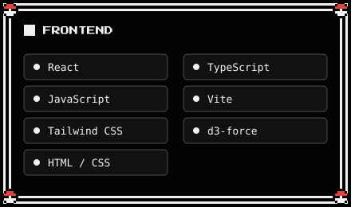</td>
<td>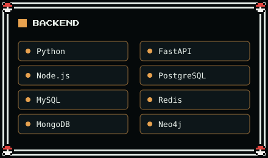</td>
</tr>
<tr>
<td>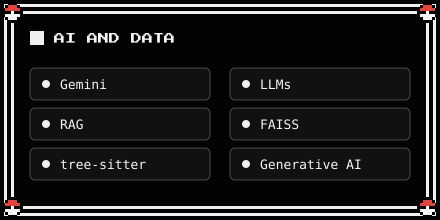</td>
<td>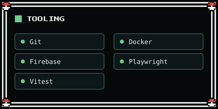</td>
</tr>
</table>

 

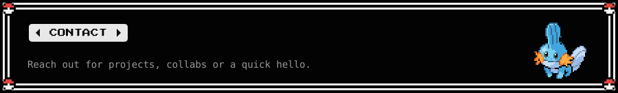

